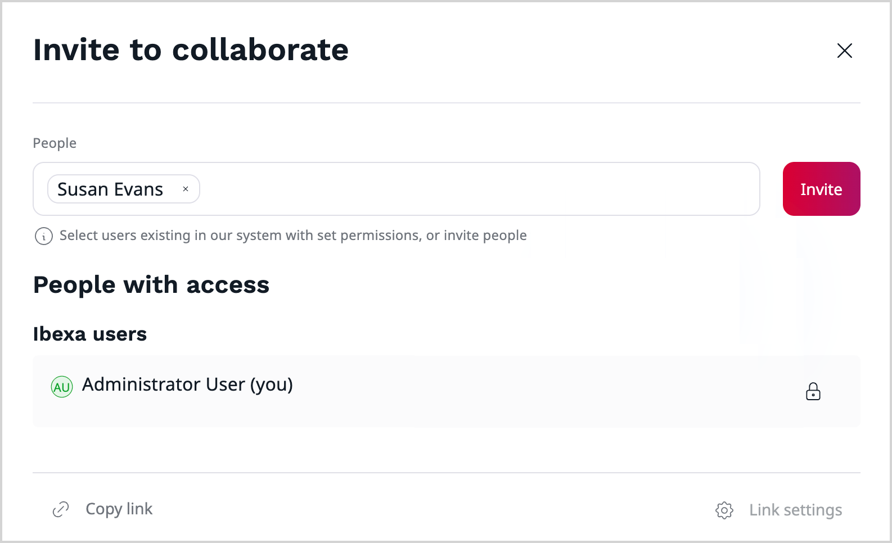

# Content sharing product guide

## What is content sharing

Content sharing is an [LTS update](editions.md#lts-updates) that allows you to share content drafts with other users, so that they can preview and review them before publication.
By giving users access to preview the content before it's published, review and collaboration become much easier.
An additional option here is the ability to copy a link to the content item, which allows to share it through communication channels.
It improves collaboration with external users, such as third-party agencies.

## Availability

Content sharing is an opt-in available as an LTS update starting with the v4.6.24 in all [[= product_name =]] editions.
To start using Content sharing, you must first install the required packages and perform initial configuration.

## How does content sharing work

### Content preview

The basic option provided by Content sharing is the ability to preview content.
This allows the user to grant preview access to logged-in users, as well as share a public link with external users.

You can share a direct link to the collaboration session using the **Copy link** button.
Link is copied to the clipboard and you can share it with the users through communication channels.

### Collaboration session

Content sharing works through a collaboration session.

When you create a new draft of a content item, you can invite other users to preview it.
This action generates a unique session for that draft.
Collaboration session begins when first invited user accepts the invitation and joins the session.

To start sharing a draft, invite users with the **Share** button.

The owner of the draft can invite other users to join the session, both internal and external:

- **Internal** - by searching their name or email address.
- **External** - by providing their email address in the field.

Invited users, both internal and external, can only preview the draft.

Once the invitation is accepted, internal users can invite further users if their permissions allow for it.
To do so, they must be a part of an active collaboration session.
Gaining access to the draft through other methods, for example by [workflow](workflow.md), doesn't allow you to invite other users.

You can remove the users' access at any time.

After inviting users to a collaboration session, they receive a notification visible on the main dashboard or by email.

Users can also join a collaboration session using the **Join** button, available:

- in the *My shared drafts* and *Drafts shared with me* tabs of the **My content** block on the dashboard
- in the **Drafts** menu
- in the **Versions** tab of the content item

The **Join** button opens the preview of the draft.
The owner of the draft is taken to the editing screen instead.

### Editing shared drafts

Sharing a draft doesn't lock it.
Other users with permissions to edit the content item can open and edit the shared draft in the usual way, for example, from the **Drafts** menu or the **Versions** tab.
Changes aren't synchronized between users who edit the same draft at the same time, so coordinate the editing work to avoid conflicting changes.

## Benefits

### Simplified content review process

With preview access to the content draft, reviewers can jump in, check the content, and approve it more quickly.
This streamlines the entire review cycle and minimizes delays caused by version confusion or slow feedback.
Review can be done even by external users without a need to set up an account in [[= product_name =]].

### Cross-functional collaboration

Content sharing allows teams to involve reviewers from across the organization and beyond.
Their feedback can be taken into account before the content is published, leading to more accurate and aligned content.

### Enhanced teamwork

All the users invited to the collaboration session work with the same draft, which makes it easier to share ideas and suggestions, and creates a stronger sense of team ownership.
