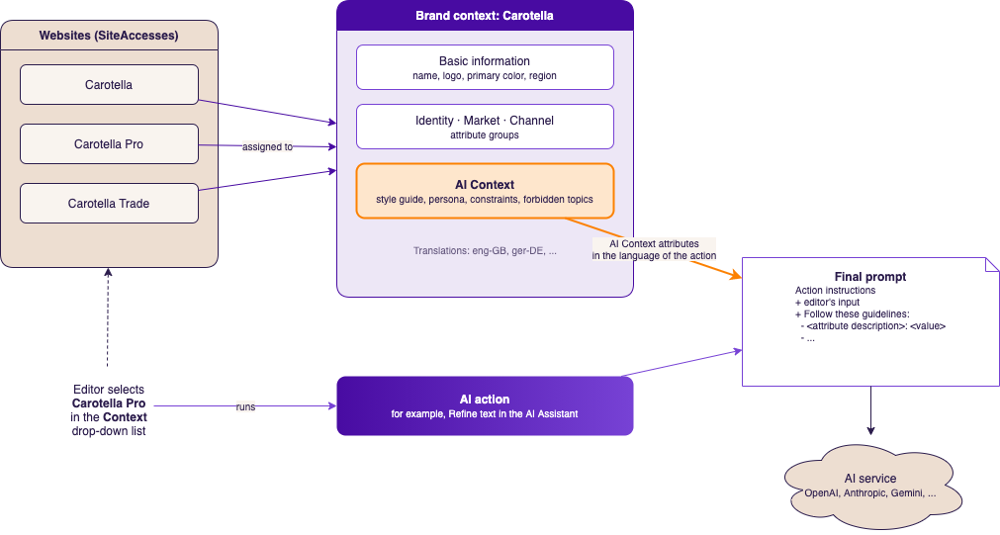
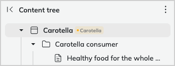
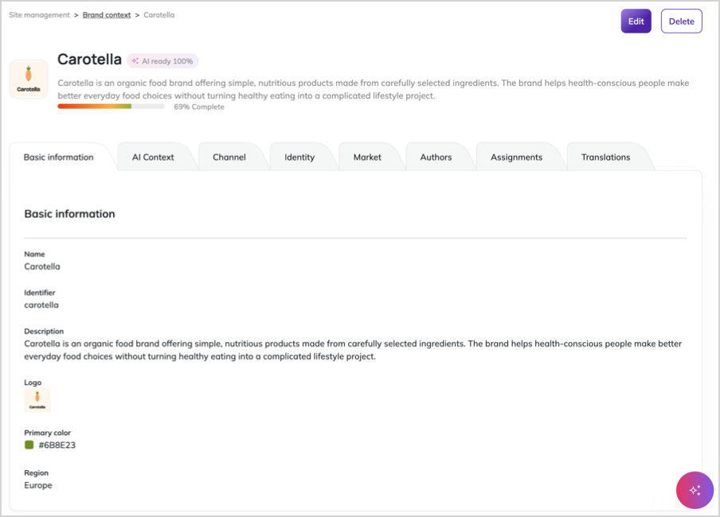
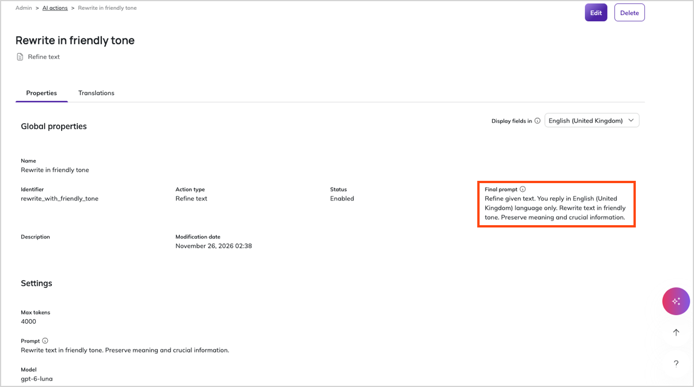
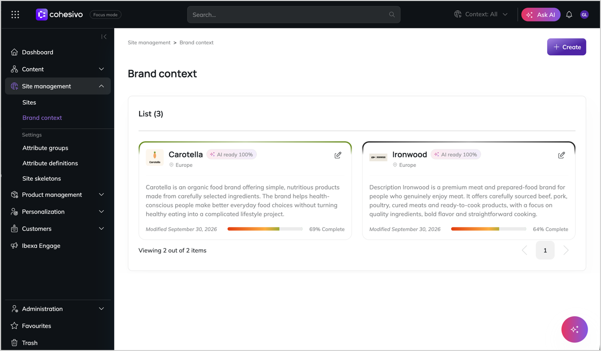
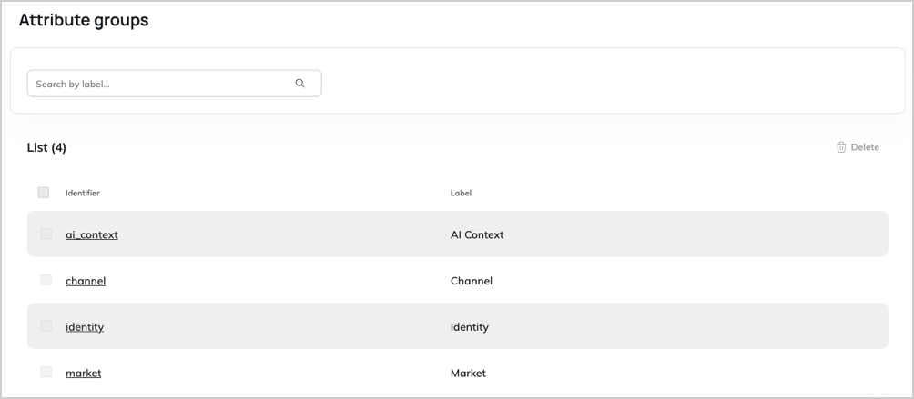

# Brand context product guide

## What is brand context

With brand context, you can describe a brand once and reuse that business perspective in all the websites that represent the brand.

A brand context holds the brand's name, logo, and colors, information about its market and communication channels, and guidelines for AI-generated content.
Editors select a website in the back office, and [[= product_name =]] applies the brand context of that website when they work with content, for example, when they use [AI actions](ai_actions_guide.md) to write or refine text.

For example, a food producer runs three websites for different audiences:

- **Carotella** - for individual customers
- **Carotella Pro** - for professional kitchens
- **Carotella Trade** - for distributors, retailers, and food processors

The websites have their own content, languages, and presentation, but they represent the same brand.
The company creates one brand context, Carotella, and assigns all three websites to it.
When editors generate text for any of these websites, the AI Assistant follows the same writing style, persona, and topics to avoid.

## Availability

Brand context is available in [[= product_name =]].

## How it works

### Brand contexts and websites

In [[= product_name =]], each website is a [SiteAccess](siteaccess.md), and you assign SiteAccesses to a brand context.
A brand context groups the [websites](multisite.md) of one brand.

The following rules apply:

- you can assign many websites to one brand context
- a website can belong to only one brand context
- all websites that belong to one brand context share the same content tree root

### Website selection in back office

In the top bar, editors select the website that they work with.

The **Context** drop-down list groups the websites by brand context, and the content tree shows a badge with the brand context name next to the root of each brand's content.

The selected website changes the back office in the following ways:

- the content tree and breadcrumbs show only the content of the selected website
- previews use the configuration of the selected website
- new content items are created in the main language of the selected website

If the selected website belongs to a brand context, [[= product_name =]] also adds the brand's AI guidelines to the prompts of AI actions.

The selection is stored as a user preference, so each editor keeps their own selection between sessions.

### Attributes

Every brand context holds some basic information, including its name, description, logo, and so on.
Other information is stored in attributes.

An attribute definition describes a single piece of information, for example, a tagline or a contact email.
Attribute definitions are organized into attribute groups, and each group has its own tab on the brand context screen in the back office.
Attribute definitions and groups are shared by all brand contexts, and each brand context stores its own attribute values.

By default, [[= product_name =]] comes with the following attribute groups:

- **Identity** - brand name, tagline, alternative logo, secondary and accent colors, heading and body fonts, tone of voice, and brand values
- **Market** - target countries and audience, currency, legal entity, and compliance notes
- **Channel** - channel type, social media profiles, contact and support information, and footer text
- **AI Context** - guidelines for AI-generated content

Administrators can add attribute definitions to any group, including AI Context, and create new attribute groups.
Attributes can be translatable, so you can provide their values in every language of the brand's websites.

### Brand context and AI

The **AI Context** attribute group is a system group that holds guidelines for AI-generated content.
By default, it contains the following information:

- detailed writing style guidelines
- what AI should and shouldn't do
- the brand persona that the AI speaks as
- topics to avoid, for example, politics or religion
- content that demonstrates the desired style
- other instructions for AI integrations

When an editor runs an AI action, for example, from the AI Assistant in the content editing form, [[= product_name =]] checks which website is selected in the top bar.
If the website belongs to a brand context, the values of the brand context's AI Context attributes are added to the prompt as guidelines.
Each guideline consists of the attribute description, which tells the AI model how to interpret the value, and the attribute value in the language of the AI action.

AI actions use only the attributes from the AI Context group.
For AI to follow any other brand information, you can move or add an attribute to the AI Context group and store the information there.

Editors can see which brand context applies to their work:

- the content editing form shows a message with the selected brand context
- the **Final prompt** field in the AI action details shows the complete prompt, including the brand guidelines

## Capabilities

### Brand management

Editors and brand managers can [create and manage brand contexts]([[= user_doc =]]/website_organization/work_with_brand_contexts/) in the back office:

- fill in the basic information and attribute values of each brand
- assign websites to brand contexts
- translate brand contexts into the languages of the brand's websites
- track how complete each brand context is, and how many of its AI guidelines are filled in
- see which brand context each website belongs to in the **Sites** list, and filter the list by brand context

### Attribute management

Administrators can [adjust the set of brand information]([[= user_doc =]]/website_organization/work_with_brand_context_attributes/) to the needs of the organization:

- create attribute groups and attribute definitions of different types, for example, text, rich text, URL, email, color, selection, or content item
- mark attributes as required or translatable
- add attributes to the AI Context group to extend the guidelines that AI actions follow

You can also manage attribute groups and definitions with [data migrations](importing_data.md#brand-context-attributes), for example, to deploy the same set of attributes to many environments.

### Access control

Access to brand contexts is controlled by [policies](policies.md#brand-context) that you can limit to selected brand contexts with the [Brand Context limitation](limitation_reference.md#brand-context-limitation).
This way, a brand manager can edit only the brand contexts of their brands.

The brand's AI guidelines apply to the AI actions of every editor who works with the brand's websites, regardless of their brand context policies.

### Extensibility

Developers can:

- manage brand contexts, their attributes, and website assignments with the [PHP API](brand_context_api.md)
- get the AI guidelines of a brand context and use them in custom AI integrations
- expose brand contexts to AI agents with the built-in [MCP tools](mcp_config.md#built-in-tools)
- [configure](configure_brand_context.md) how brand context works in the back office

## Benefits

### Consistent brand voice

AI-generated content follows the same guidelines on every website of the brand, regardless of which editor creates it.
Editors don't have to repeat the brand's style rules in every prompt.

### One source of brand information

Brand information is stored in one place instead of being scattered across documents and the configuration of individual websites.
When the brand guidelines change, you update the brand context, and AI actions on all the brand's websites follow the new guidelines.

### Clear structure of a multi-brand installation

The **Context** drop-down list and the badges in the content tree show which websites and content belong to which brand.
Editors who work with many brands always know in which brand's context they work.
